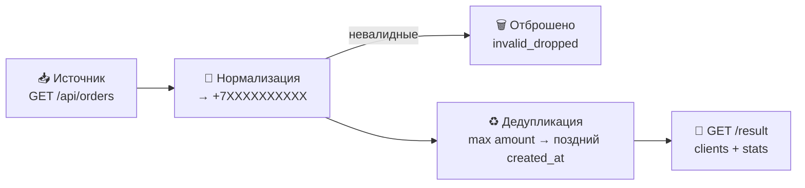

<div align="center">

# 🔄 Orders Sync Service

**Синхронизатор заявок: собирает «сырые» лиды из внешнего источника, приводит телефоны к формату `+7XXXXXXXXXX`, схлопывает дубли и отдаёт готовый JSON по REST API.**

[](https://bs-test-task.onrender.com/result)
[](https://bs-test-task.onrender.com/health)


</div>

---

## 📖 О проекте

Заявки с лендингов, рекламных форм и внешних систем приходят «как есть»: телефоны в десятке форматов, дубли, опечатки. Перед загрузкой в CRM такой поток нужно привести в порядок — этим и занимается сервис:

```
📥 Источник            🧹 Нормализация        ♻️ Дедупликация         🧾 API
/api/orders      →     +7XXXXXXXXXX     →    по бизнес-правилам →    GET /result
(сырой JSON)           мусор отброшен         max amount              чистый JSON
```

---

## ✨ Возможности

- 📥 **Забирает заявки** из внешнего JSON-источника (`/api/orders`) — адрес задаётся через `SOURCE_URL`
- 🧹 **Нормализует телефоны** к единому формату `+7XXXXXXXXXX`, невалидные значения отбрасывает
- ♻️ **Дедуплицирует по телефону** по прозрачным бизнес-правилам (см. ниже)
- 🧾 **Отдаёт чистый JSON** строго по схеме — без лишних полей
- 🔁 **Идемпотентен**: повторные синхронизации не плодят дубли, результат детерминирован
- ⚡ **Кэш на 30 секунд** и деградация без сбоев: если источник недоступен — отдаётся последний успешный результат с пометкой `X-Sync-Stale`
- 🩺 **Наблюдаемость**: заголовки `X-Sync-Age` / `X-Sync-Stale`, health-эндпоинт с метриками
- 🫀 **Работает 24/7 на free-плане Render**: self-ping каждые 5 минут не даёт инстансу заснуть

---

## 🧹 Нормализация телефонов

| На входе | На выходе | Результат |
|---|---|---|
| `+7 999 123-45-67` | `+79991234567` | ✅ |
| `8 (999) 123 45 67` | `+79991234567` | ✅ |
| `79991234567` | `+79991234567` | ✅ |
| `8-916-000-00-01` | `+79160000001` | ✅ |
| `9005551212` (10 цифр, без кода) | `+79005551212` | ✅ |
| `123` · `не указан` · `+7 999` · пусто | — | ❌ отброшено |

## ♻️ Правила дедупликации

При дубле по телефону остаётся одна запись:

1. с **максимальным `amount`**;
2. при равных `amount` — **более поздняя по `created_at`**;
3. тай-брейк для полной детерминированности — больший `id`.

---

## 🚀 Быстрый старт

```bash
# 1. Клонировать и установить зависимости
git clone https://github.com/AndreyBychenkow/orders-sync-service.git
cd orders-sync-service
pip install -r requirements.txt

# 2. Запустить
uvicorn app.main:app --reload

# 3. Открыть результат
# http://localhost:8000/result
```

### 🐳 Docker

```bash
docker build -t orders-sync .
docker run -p 8000:8000 orders-sync
```

---

## 🔌 API

| Метод | Путь | Описание |
|---|---|---|
| `GET` | `/result` | **Итоговый JSON** — клиенты + статистика |
| `GET` | `/` | То же самое |
| `GET` | `/sync` | Принудительная синхронизация с источником |
| `GET` | `/health` | Статус: время последнего синка, состояние прогрева |

### 📦 Пример ответа

```json
{
  "clients": [
    {
      "name": "Иван П.",
      "phone": "+79991234567",
      "email": "ivan@example.com",
      "amount": 5000
    }
  ],
  "stats": {
    "received": 17,
    "unique": 8,
    "duplicates_merged": 5,
    "invalid_dropped": 4
  }
}
```

---

## 🏗 Как это работает



---

## 🧪 Тесты

```bash
python tests/test_sync.py
```

Покрыто: нормализация всех форматов телефонов и мусора, правила дедупликации, идемпотентность.

---

## ⚙️ Конфигурация

| Переменная | По умолчанию | Назначение |
|---|---|---|
| `SOURCE_URL` | `https://test.ooobs.ru/api/orders` | Источник «сырых» заявок |
| `CACHE_TTL` | `30` | Секунд между синхронизациями |
| `KEEPALIVE_MINUTES` | `5` | Интервал self-ping, мин (`0` — выключить) |
| `HTTP_TIMEOUT` | `15` | Таймаут запроса к источнику |

> 🔐 **Секретов в коде нет.** Всё конфигурируется через переменные окружения (Render Dashboard / `.env` локально), в репозиторий не коммитятся.

## ☁️ Деплой

Проект разворачивается в один клик на [Render](https://render.com) через `render.yaml` (Docker). После старта сервис сам себя пингует и не засыпает на free-плане.

---

## 📁 Структура проекта

```
orders-sync-service/
├── app/
│   └── main.py          # FastAPI: API, нормализация, дедупликация, кэш, self-ping
├── tests/
│   └── test_sync.py     # юнит-тесты бизнес-логики
├── Dockerfile           # сборка образа
├── render.yaml          # конфиг деплоя Render
├── requirements.txt     # зависимости
└── README.md
```

## 📄 Лицензия

Проект распространяется под лицензией [MIT](LICENSE).

---

<div align="center">

Сделано с ❤️ на Python + FastAPI

</div>
